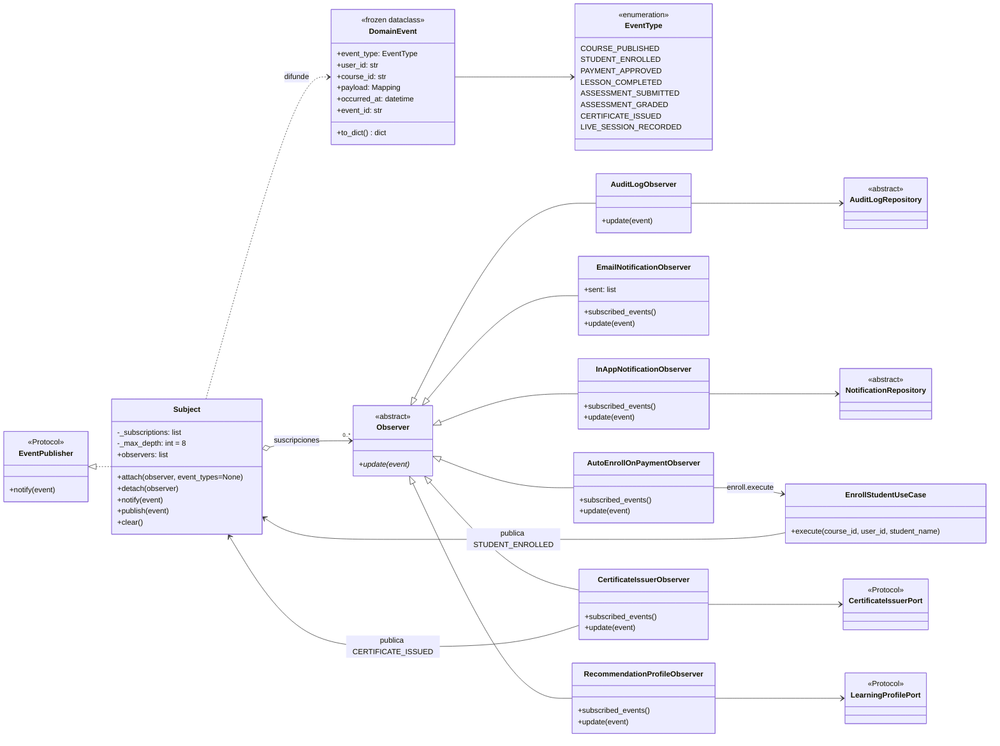

# Observer: diagrama de clases

Fuente: `app/shared/domain/events.py`, `app/shared/domain/observers.py`,
`app/modules/*/application/observers.py` y el cableado en `app/shared/infrastructure/container.py`
(`wire_event_bus`). Se muestran solo los métodos relevantes al patrón.

## Suscripciones (según `wire_event_bus`)

| Observador | Eventos |
|---|---|
| `AuditLogObserver` | todos (sin filtro) |
| `EmailNotificationObserver` | `STUDENT_ENROLLED`, `PAYMENT_APPROVED`, `CERTIFICATE_ISSUED` |
| `InAppNotificationObserver` | `COURSE_PUBLISHED`, `STUDENT_ENROLLED`, `PAYMENT_APPROVED`, `ASSESSMENT_GRADED`, `CERTIFICATE_ISSUED`, `LIVE_SESSION_RECORDED` |
| `AutoEnrollOnPaymentObserver` | `PAYMENT_APPROVED` |
| `CertificateIssuerObserver` | `ASSESSMENT_GRADED` (solo si `payload.passed`) |
| `RecommendationProfileObserver` | `STUDENT_ENROLLED`, `LESSON_COMPLETED`, `ASSESSMENT_GRADED`, `CERTIFICATE_ISSUED` |

`LIVE_SESSION_RECORDED` se notifica in-app al instructor y a los inscritos del curso **en ese momento**
(`_COURSE_WIDE` en `InAppNotificationObserver`).
