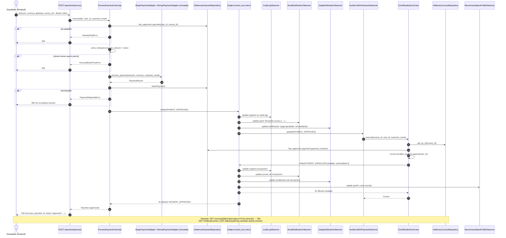
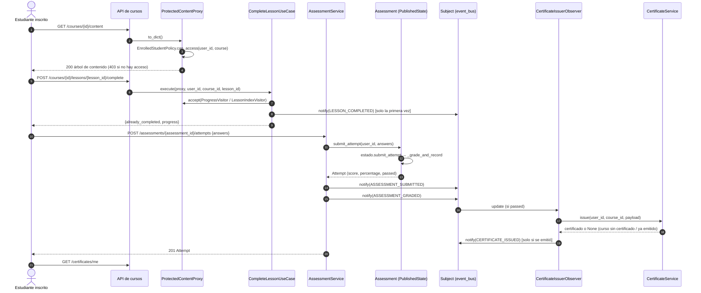

# Secuencia: pago → PAYMENT_APPROVED → auto-inscripción → STUDENT_ENROLLED

Fuente: `app/modules/payments/infrastructure/api.py`, `ProcessPaymentUseCase`
(`app/modules/payments/application/use_cases.py`), `Subject.notify` (`app/shared/domain/events.py`),
`AutoEnrollOnPaymentObserver` (`app/modules/courses/application/observers.py`),
`EnrollStudentUseCase` (`app/modules/courses/application/use_cases.py`) y el cableado de
`wire_event_bus` (`app/shared/infrastructure/container.py`).

Todo ocurre **en la misma petición HTTP y en el mismo hilo** (bus síncrono en memoria). El orden de
los observadores es el orden de `attach` en `wire_event_bus`: auditoría, correo, in-app,
auto-inscripción, certificados, recomendaciones (cada uno filtra por tipo de evento).

## Notas

- Un observador que lanza excepción se registra con `logging` y no detiene a los demás ni al pago
  (`Subject.notify`). Si la inscripción automática falla, el pago queda aprobado igualmente.
  `AutoEnrollOnPaymentObserver` además captura `AlreadyEnrolledError` y `CourseNotFoundError` y solo
  los registra en el log.
- Guardas contra bucles: un observador no recibe otro evento del mismo tipo mientras procesa uno, y la
  cadena anidada se corta en `max_depth = 8`.
- Pruebas que cubren este flujo: `test_observer.py::test_encadenado_legitimo_pago_a_inscripcion`,
  `test_observer.py::test_api_pago_inscribe_automaticamente`,
  `test_correcciones.py::test_pago_luego_inscripcion_y_contenido`, `test_flow_e2e.py::test_flujo_completo_de_la_demo`.

## Continuación: contenido → lección → evaluación → certificado

Fuente: `app/modules/courses/infrastructure/api.py` (Proxy y progreso), `CompleteLessonUseCase`,
`AssessmentService.submit_attempt`, `CertificateIssuerObserver` y `CertificateService.issue`.

