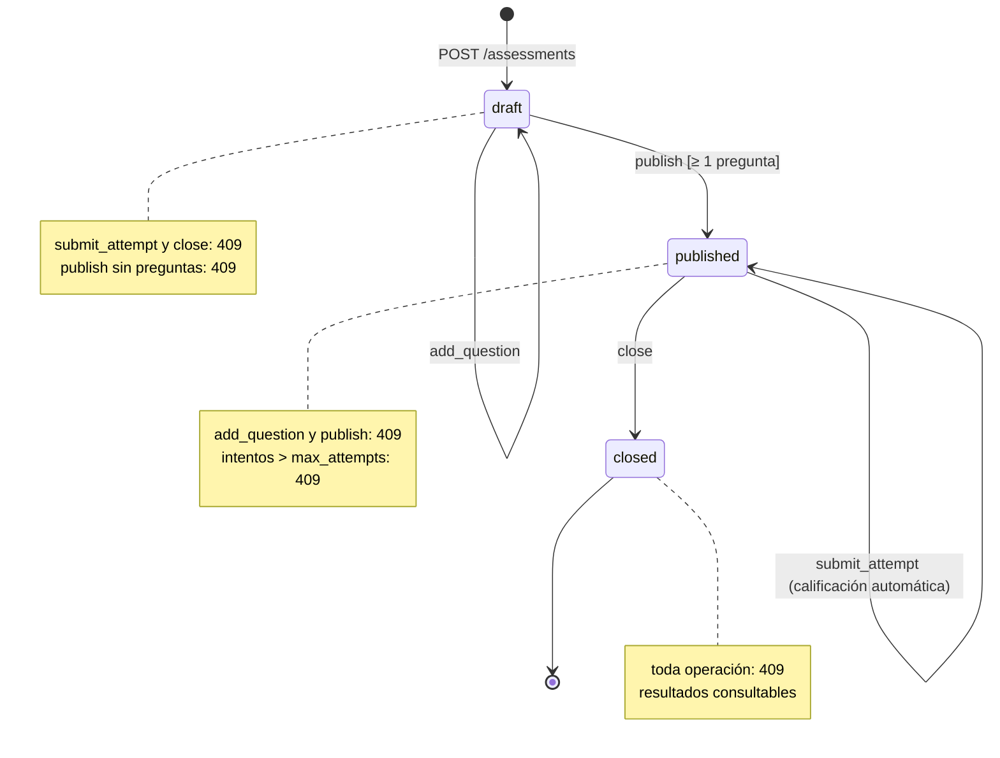
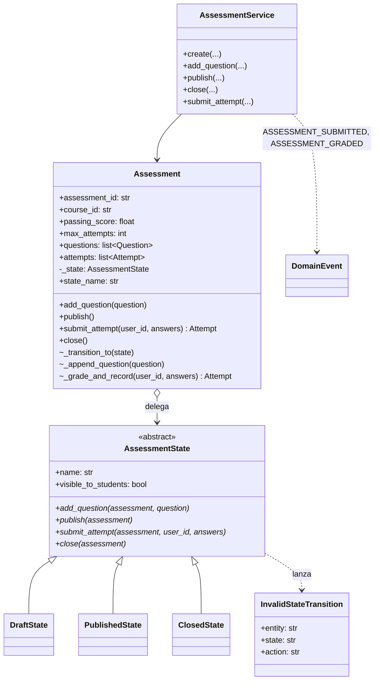
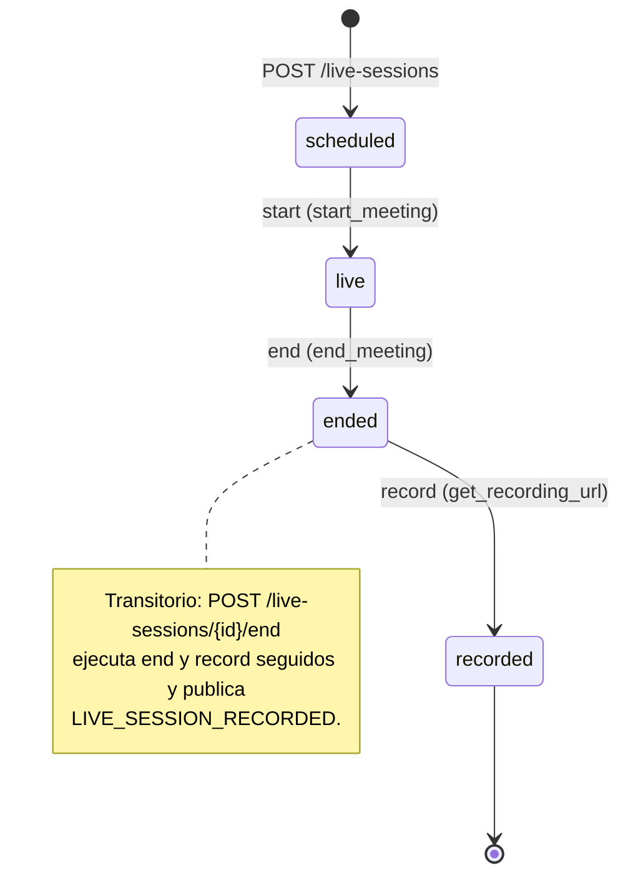
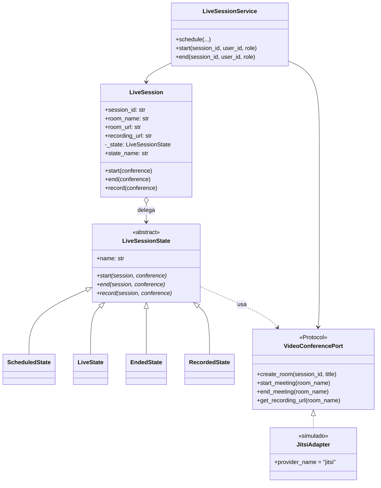

# State: evaluaciones y clases en vivo

Fuente: `app/modules/assessments/domain/{models,states}.py`,
`app/modules/live_sessions/domain/{models,states}.py`, `app/shared/domain/state.py`.
Una operación no permitida en el estado actual lanza `InvalidStateTransition`, que la API
traduce a **409**.

## Evaluaciones: diagrama de estados

## Evaluaciones: diagrama de clases

## Clases en vivo: diagrama de estados

## Clases en vivo: diagrama de clases

