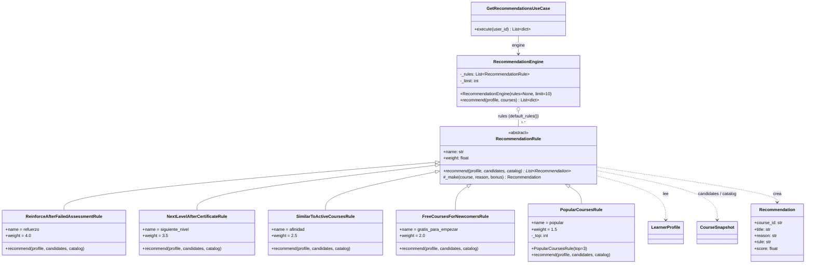

# Strategy en el motor de recomendaciones

Fuente: `app/modules/recommendations/domain/strategies.py` (estrategias y contexto),
`app/modules/recommendations/domain/models.py` (`LearnerProfile`, `CourseSnapshot`, `Recommendation`) y
`app/modules/recommendations/application/use_cases.py` (`GetRecommendationsUseCase`).

Notas:

- `default_rules()` devuelve las cinco reglas concretas en el orden del diagrama. `RecommendationEngine`
  las usa cuando `rules` es `None`.
- El motor excluye los cursos inscritos y los propios antes de llamar a las reglas. Por curso conserva la
  recomendación de mayor `score` y acumula todos los motivos en `reasons`.
- `SimilarToActiveCoursesRule` usa `profile.progress`, que el caso de uso llena con el progreso calculado
  por `ProgressVisitor` (puerto `ProgressReaderPort`).
- Endpoint: `GET /recommendations/me`.
