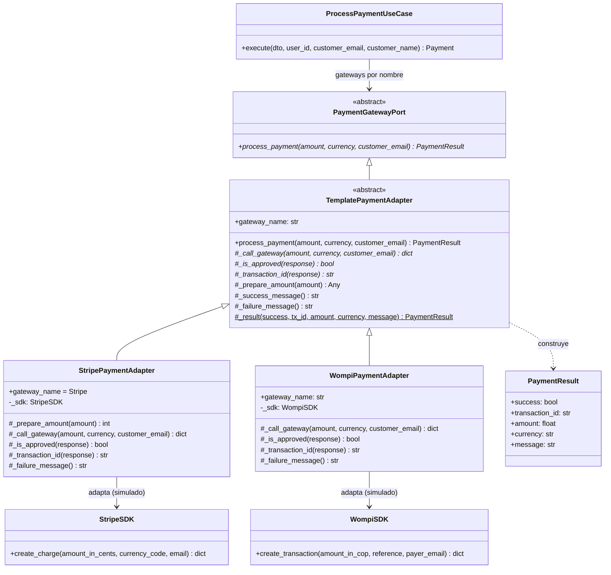

# Template Method en las pasarelas de pago

Fuente: `app/modules/payments/domain/adapter.py`. Consumidor: `ProcessPaymentUseCase` en
`app/modules/payments/application/use_cases.py`.

Orden fijo de `process_payment` (método plantilla; ninguna subclase lo sobrescribe):

1. Validar `amount > 0`. Si falla, devuelve un rechazo sin llamar al SDK.
2. Pasar `currency` a mayúsculas.
3. `_prepare_amount(amount)`: gancho. Por defecto devuelve el mismo monto; Stripe lo pasa a centavos con `round`.
4. `_call_gateway(...)`: paso abstracto. Una excepción del SDK se registra con `logging` y se convierte en rechazo.
5. `_is_approved(response)` y `_transaction_id(response)`: pasos abstractos.
6. `_success_message()` o `_failure_message()`: ganchos con mensaje por defecto.
7. `_result(...)`: construye el `PaymentResult`.

`WompiPaymentAdapter.gateway_name` vale `"Wompi (Colombia)"` (se omite en el diagrama porque Mermaid lee los paréntesis como método).

Leyenda: `*` = abstracto, `$` = estático, `#` = protegido por convención (prefijo `_`).
Los SDK son simulados: no hay red ni claves.
