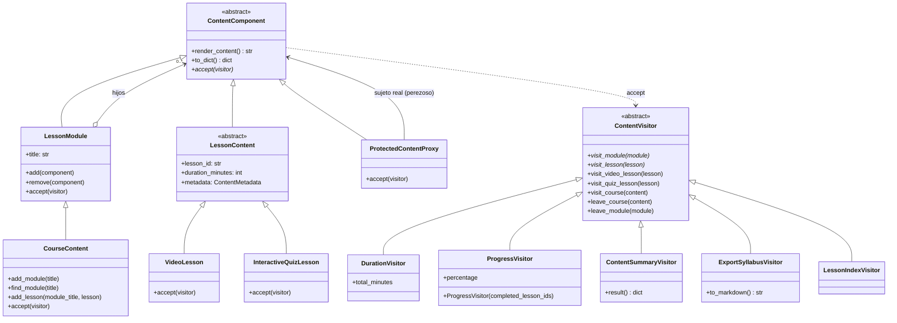

# Visitor sobre el Composite de contenido

Fuente: `app/modules/courses/domain/visitor.py`, `content_component.py`, `composite.py`,
`bridge.py` y `content_proxy.py`.

## Doble despacho

| Nodo | `accept(visitor)` llama a |
|---|---|
| `CourseContent` | `visit_course`, hijos, `leave_course` (la raíz no cuenta como módulo) |
| `LessonModule` | `visit_module`, hijos, `leave_module` |
| `VideoLesson` | `visit_video_lesson` (por defecto delega en `visit_lesson`) |
| `InteractiveQuizLesson` | `visit_quiz_lesson` (por defecto delega en `visit_lesson`) |
| `ProtectedContentProxy` | valida el acceso; si no hay, lanza `ContentAccessDenied` (403); si hay, delega en el sujeto real |

## Dónde se usa

- `GET /courses/{course_id}/content/summary`: `ContentSummaryVisitor` + `ExportSyllabusVisitor` a través del Proxy.
- `POST /courses/{course_id}/lessons/{lesson_id}/complete` y `GET /courses/{course_id}/progress/me`:
  `CompleteLessonUseCase` / `GetProgressUseCase` recorren el Proxy de progreso.
- Recomendaciones: `VisitorProgressReader` (composition root) aplica `ProgressVisitor`.
